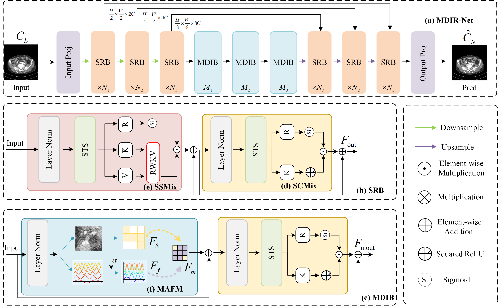

# 🩻 MDIR-Net

**Multi-feature Dynamic Interaction and Receptance Weighted Key-Value Network for LDCT Denoising**

---

## 📄 Abstract

Noise reduction in low-dose computed tomography (LDCT) is essential for enhancing both image quality and diagnostic accuracy. Deep learning methods has been widely accepted as a powerful tool for LDCT image denoising. However, existing methods primarily focus on modeling with the noise level feature, while neglecting the fine characterization and interactions of spatial structural information in LDCT. To address this issue, we propose a Multi-feature Dynamic Interaction and Receptance Weighted Key-Value Network (MDIR-Net) for LDCT denoising. MDIR-Net employs efficient directional sequence modeling to capture local spatial dependencies and incorporates a multi-feature dynamic adaptive interaction block to facilitate information exchange between spatial and frequency-domain representations. Specifically, the symmetric guided receptance block (SRB) incorporates the proposed symmetric token shift (STS) mechanism into RWKV modeling to enhance local spatial and structural representations. Then the multi-feature dynamic adaptive interaction block (MDIB) is designed to enable the proposed framework to achieve synergistically integrating multi-feature adaptive learning, and provide dual-domain guidance from both frequency and image perspectives. Experiments were conducted on the AAPM dataset, a real piglet dataset with multiple dose levels, and a mixed dataset. Quantitative and visual results demonstrate that MDIR-Net provides effective LDCT denoising and preserves anatomically relevant image structures.

## 🏗️ Framework

The overall architecture of the proposed MDIR-Net is illustrated below.

> ⚠️ **Note:** This manuscript has been submitted to a peer-reviewed journal.
> The full paper, together with the complete source code and pre-trained models,
> will be publicly released upon acceptance. Thank you for your patience.

## 📚 Citation

Citation information will be made publicly available after the paper is accepted.

---

If you have any questions, feel free to open an issue. ⭐ Star this repository to keep track of updates!

